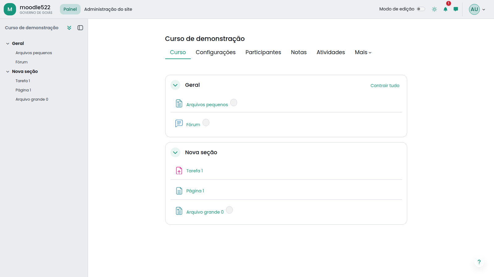

# Goiás theme for Moodle

A **Boost** child theme that brings the **Design System Goiás** to Moodle: the
UI kit of the State of Goiás (Expresso, `@expresso/componentes-angular-expresso`)
with the same tokens, components and behaviour. It uses the **Poppins** typeface,
the government green, pill buttons, bordered cards and **light, dark and high
contrast** colour schemes.

## Features

- **Design tokens in three layers**, as in the design system: raw palette
  (Expresso greys, feedback and secondary colours), semantic tokens per scheme
  (`--goias-surface`, `--goias-fg`, `--goias-line`, `--goias-primary`...) and the
  components, which only read the tokens.
- **Components** mapped onto Moodle markup: buttons (primary, secondary,
  tertiary, danger, with the brand halo on hover), icon buttons, fields, labels
  and validation messages, checkboxes and switches, cards, menus, modals,
  alerts, tags (badges) and counters, underlined tabs, tables, paginator,
  progress bar, breadcrumb and avatars.
- **App shell**: translucent navbar with the LogoMark (monogram, site name and
  organisation), primary navigation and course index as sidebar items, drawers
  on the canvas colour.
- **Login page** in the AuthLayout of the design system: government bar,
  "back to home" link, colour scheme selector and a centred card with the brand
  panel on the left.
- **Colour schemes**: light, dark, high contrast (black, white and amber) or
  follow the device, chosen in a menu in the navigation bar. The choice is
  saved as a user preference (in the browser for guests).
- **Brand colour**: government green (`#15967d`) by default, `#0b7675` for the
  citizen context, or any colour; the strong, complementary and dark tones are
  derived from it.
- **Logos**: logo and compact logo uploaded in the theme settings (they override
  the site logos from *Appearance > Logos*).
- **Self-hosted font**: no request is sent to external font services.
- Raw SCSS (before and after) for further customisation.

## Requirements

- Moodle 5.2 or later (5.2 branch).
- Boost theme (shipped with Moodle).

## Installation

1. Copy this folder to `public/theme/goias` (or install the ZIP from
   *Site administration > Plugins > Install plugins*).
2. Complete the upgrade at *Site administration > Notifications*.
3. Select the theme at *Site administration > Appearance > Themes*.

## Settings

*Site administration > Appearance > Themes > Goiás*

| Tab | Setting | Description |
| --- | --- | --- |
| General | Brand colour | Buttons, links, active items, login panel. |
| General | Logo / Compact logo | Login page and navigation bar. |
| General | Organisation | Shown in the LogoMark, the government bar and the login panel. |
| Colour scheme | Let users choose the colour scheme | Shows the scheme menu. |
| Colour scheme | Default colour scheme | Follow the device, light, dark or high contrast. |
| Login page | Government bar / portal link | Official site bar on the login page. |
| Login page | Title / Text | Copy of the login brand panel. |
| Advanced | Raw SCSS | Extra SCSS before/after the theme styles. |

## Support

- Source code: https://github.com/EliasSantiago/moodle-goias
- Bug tracker: https://github.com/EliasSantiago/moodle-goias/issues

## Privacy

The theme stores one user preference, `theme_goias_colorscheme` (light, dark,
contrast or auto). It is described and exported by the Privacy API provider.

## License

GNU GPL v3 or later. See [LICENSE](LICENSE).

Poppins is licensed under the SIL Open Font License 1.1
([fonts/OFL.txt](fonts/OFL.txt)). Icons from Heroicons (MIT).

## Authors

Elias Fonseca, Cesar Augusto, 2026.
